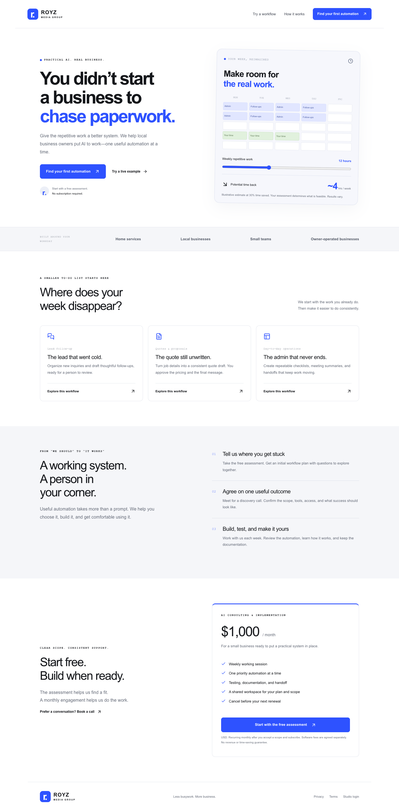
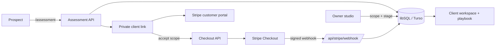

# Royz AI Consulting

A complete operating system for a small AI-implementation service: a public site with a free assessment, an owner studio for scoping and delivery, private client workspaces, and a $1,000/month Stripe subscription that only starts after the client accepts a written scope. Live at [royz-ai-consulting.vercel.app](https://royz-ai-consulting.vercel.app).



## Why

Selling AI help to a local service business is mostly operations: qualify the lead, find one repetitive task worth fixing, agree on scope, take payment, and show progress. This app runs that whole loop for a one-person studio, and it is strict about honesty. It doesn't show fake testimonials, results or availability, and it won't call a client paid until Stripe confirms it.

## Features

**Consulting service**
- **Free assessment** (`/assessment`) that asks about one repetitive task (frequency, minutes per occurrence, current tools) and saves it on the server before confirming. The visitor gets a private client link and a rules-based starter plan with clearly labeled time estimates.
- **Owner studio** (`/studio`, password login): prospects and assessments move through stages, with notes, next actions, the proposed workflow, weekly tasks and measured outcomes. Records can be exported.
- **Scope-gated billing**: the client accepts the exact scope shown (hashed), then checks out through Stripe. A signed webhook is the only thing that can mark a client Active. Unpaid checkouts can be cancelled to unlock the scope for revision, and the Stripe customer portal handles invoices, payment methods and cancellation.
- **Client workspace** (`/client/[token]`): progress, tasks and a downloadable delivery playbook.
- **Workflow starters** (`workflows/`): three local Node scripts that turn sample intake, quote and admin data into review-ready drafts.

**Royz Creative** (`/creative`), a second service in the same codebase
- A $350 one-time static-ad package for a single coffee SKU: intake, owner approval, QA checklist, revisions and delivery.
- Private PNG uploads stored as database BLOBs, with checks on PNG structure and dimensions, SHA-256 dedupe, and size caps. A client can download files only after delivery.
- An append-only audit log for every job change, plus a cost ledger in integer cents. Paid generation stays disabled behind a $0 budget gate.

**Security**: signed owner session cookie, same-origin checks on mutations, rate-limited public endpoints, 64-character bearer tokens for client links, and public projections that strip contact details, notes and internal economics.

## How it works



## Tech stack

Next.js 16 (App Router), React 19, TypeScript, Zod, libSQL (Turso in production, local SQLite in development), Stripe (Checkout, Billing Portal, webhooks), lucide-react, Playwright for browser checks, Node test runner with `tsx`. Hosted on Vercel.

## Getting started

```sh
npm install
cp .env.example .env.local   # set AUTH_SECRET and ADMIN_PASSWORD at minimum
npm run dev                  # http://127.0.0.1:3091
```

With no Turso URL, development uses SQLite under the ignored `data/` folder. To set up billing, add a Stripe secret key and run `node scripts/setup-stripe.mjs`, which creates a dedicated billing-portal configuration and webhook endpoint and appends their IDs to `.env.local`.

```sh
npm test                           # unit and security tests
node --test workflows/*.test.mjs   # workflow starter tests
npm run typecheck
npm run build
```

`scripts/browser-check.mjs` and `scripts/public-smoke.mjs` are browser checks against a running build (set `CHROME_PATH` if needed). `scripts/e2e.mjs` is an opt-in live check that creates a QA assessment and an unpaid checkout, expires it, and deletes its own record. It never enters payment details.

## Project structure

```
src/
  app/            public pages, /assessment, /studio, /client/[token], /creative/*, API routes
  components/     studio, client workspace, prospect record, creative UI
  lib/            db, billing, security, planner, creative core/ledger/assets/billing
workflows/        runnable intake, quote and admin starters with sample inputs
scripts/          Stripe setup, browser checks, live smoke tests
tests/            security, creative workflow, ledger and asset tests
docs/             service playbook, source-to-product notes, creative backend and design docs
public/creative/  fictional sample pack used on the creative demo
```

## Status

Live at [royz-ai-consulting.vercel.app](https://royz-ai-consulting.vercel.app). Owner login, assessment intake, scope acceptance, live unpaid checkout, cancellation and signed webhook handling have been verified in production. No paying clients yet. The sample creative work is fictional spec work.

Built by [Ian Royes](https://github.com/ianroyes-sys)
